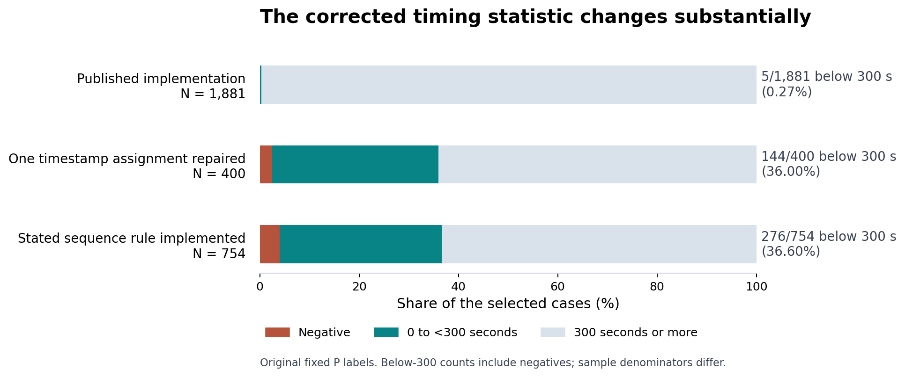
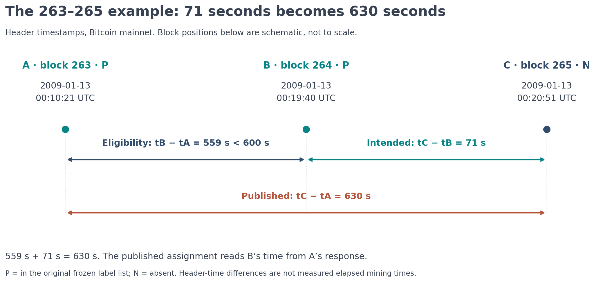
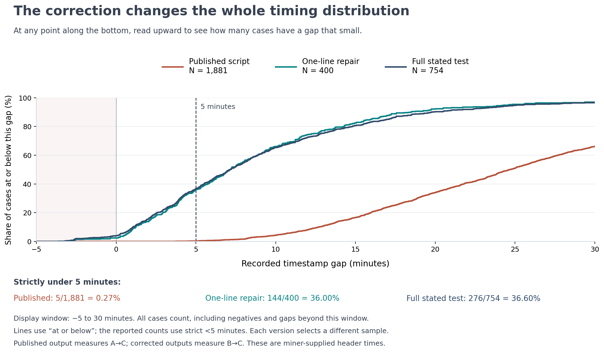
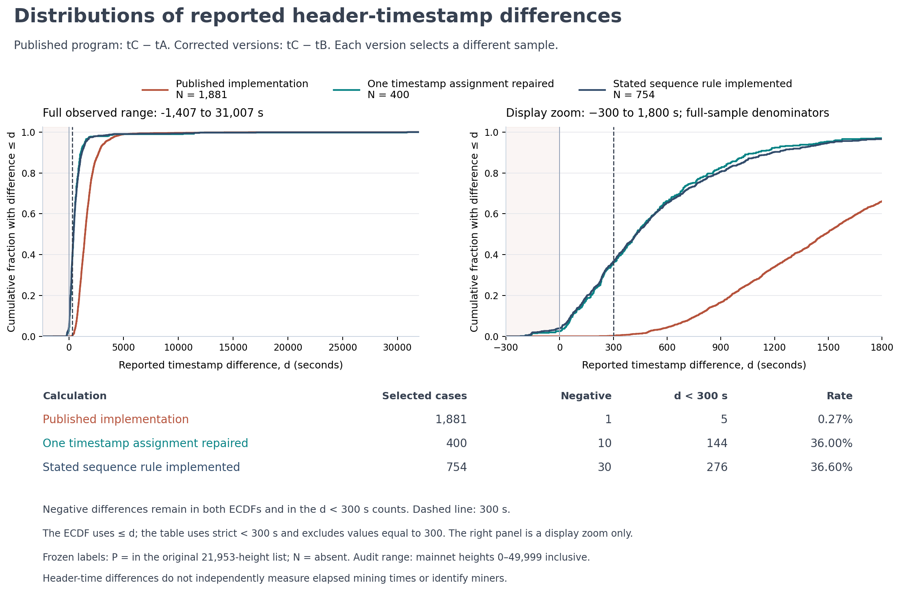
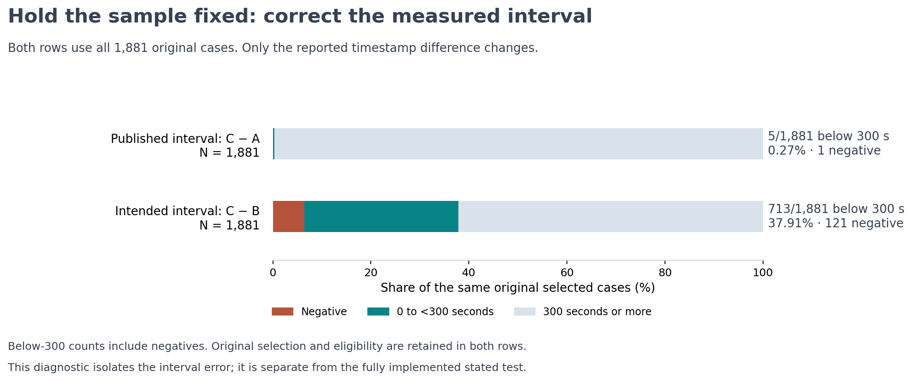
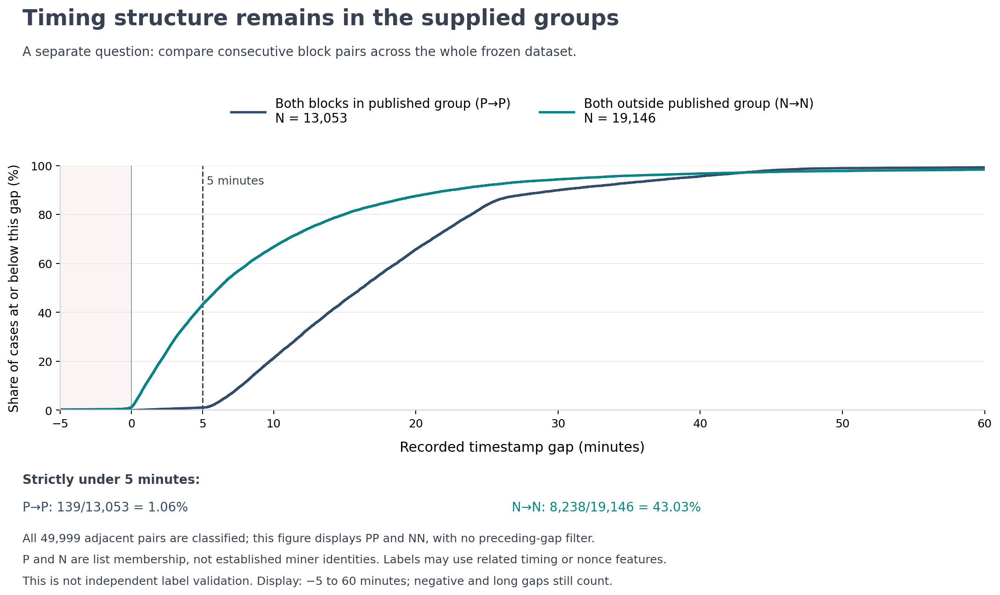

# Patoshi Timing Audit

**Zakk Easterbrook · The early-Bitcoin mystery, one mistaken timestamp, and what changes after correction**

[](https://github.com/zakkeasterbrook/-patoshi-timing-audit/actions/workflows/verify.yml)

Bitcoin’s early blocks left a record of numbers, mining fingerprints and clock times. Researchers have studied those records for years, asking whether many early blocks came from one mining operation and whether it could have been connected to Satoshi Nakamoto, the name used by Bitcoin’s creator.

That is the background to the **Patoshi hypothesis**. This project follows one later timing test back to its source code, finds a concrete mistake, and reproduces what happens when it is corrected.

**The Patoshi idea did not come from Jameson Lopp’s 2022 test. Correcting that test does not, by itself, erase the earlier research.** It changes one particular piece of numerical evidence in that discussion.

The specific change is large: the published script reports **5 recorded gaps under five minutes among 1,881 cases**. Implementing the stated test gives **276 among 754**. Both calculations use the same underlying headers and labels; they select different samples. The totals include negative timestamp differences, explained below.



**Follow the story:** [The background](#1-the-mystery-came-first) · [The test](#2-the-question-the-timing-test-asked) · [The real example](#3-three-blocks-show-the-mistake) · [Results and line graphs](#5-what-the-line-graphs-show) · [What remains](#7-what-remains-in-the-data) · [Reproduce it](#check-it-yourself)

## 1. The mystery came first

A Bitcoin **block** is a batch of transactions added to the network’s ordered ledger. **Miners** compete to add the next block. A block’s **height** is simply its position in that sequence.

Researchers examining the early records noticed patterns in how some blocks appeared to have been produced. Earlier work studied mining-related counters and search values, not just the time written on each block. “Patoshi” became the name associated with a proposed early mining pattern.

The important distinction is between **seeing a pattern**, **assigning blocks to one mining operation**, and **identifying the person behind it**. Those are three different claims.

| When | Part of the story |
|---|---|
| **2013** | Sergio Demian Lerner published [early mining-pattern research](https://bitslog.com/2013/04/17/the-well-deserved-fortune-of-satoshi-nakamoto/). |
| **2019** | His [Patoshi and nonce-range work](https://bitslog.com/2019/04/16/the-return-of-the-deniers-and-the-revenge-of-patoshi/) examined further mining fingerprints. |
| **2020** | [Timestamp research](https://bitslog.com/2020/06/22/a-new-mystery-in-patoshi-timestamps/) discussed unusual spacing and possible pause or clock explanations. |
| **2022** | Jameson Lopp’s [“Was Satoshi a Greedy Miner?”](https://blog.lopp.net/was-satoshi-a-greedy-miner/) included the specific timing test audited here. |
| **2026** | This audit reproduces that script, isolates its error, and separately implements its stated rule. |

This repository does **not** rebuild the entire original Patoshi classification method. It takes the published list of labels as a fixed input so that a code correction can be examined without changing which blocks were originally classified.

Here, **P** means “in the supplied Patoshi list” and **N** means “outside that list.” Neither label proves who mined a block; N does not prove a different real-world miner.

## 2. The question the timing test asked

One question in the wider discussion was whether unusual timing reflected mining behaviour, such as pauses, or behaviour in the timestamps themselves.

The 2022 test looked for this specific sequence:

1. A block in the published group: **A — P**.
2. Another consecutive block in that group: **B — P**, with its timestamp less than ten minutes after A’s.
3. The next consecutive block outside the group: **C — N**.

It then measured the timestamp difference **from B to C**. In this test, a “short” following difference means **strictly under five minutes**, or 300 seconds.

The published result looked striking: **only five short differences among 1,881 selected cases**. This is the count the audit investigates.

There is an essential clock warning. Every block has a small identifying record called a **header**, including a timestamp supplied by its miner. It is **not an independent stopwatch reading of when the block was discovered**. Different clocks can even make the next block’s recorded time earlier than the previous block’s time. A negative difference describes those recorded times, not negative elapsed time.

## 3. Three blocks show the mistake

The problem becomes concrete with blocks **263, 264 and 265**, recorded on 13 January 2009.

The first two are in the supplied group. The third is outside it.

- **263 → 264:** 559 seconds, or **9 minutes 19 seconds**. This passes the under-ten-minute condition.
- **264 → 265:** 71 seconds, or **1 minute 11 seconds**. This is the intended measurement.
- **263 → 265:** 630 seconds, or **10 minutes 30 seconds**. This is what the published program reports.

**A recorded difference of 71 seconds becomes 630 seconds because the program starts one block too early.**



The source fetches the second block, but then reads the first block’s timestamp into the variable meant for the second.

That has two consequences. It adds the preceding gap to the reported difference. It also makes the intended ten-minute filter automatically pass: the program effectively asks whether a time is less than that same time plus ten minutes.

<details>
<summary>See the exact one-line source correction</summary>

The [immutable upstream source](https://github.com/jlopp/bitcoin-utils/blob/66ee906b28ca13269d6f71d63f848973a1b747a2/findNonPatoshiDeltasAfterFastPatoshiBlocks.php) contains the wrong-object assignment:

```diff
-$patoshiBlock2Time = $patoshiBlock1->get('time');
+$patoshiBlock2Time = $patoshiBlock2->get('time');
```

For consecutive A, B, C, the stated rule requires `tB − tA < 600` and measures `tC − tB`. The defective assignment instead makes the filter `tA < tA + 600` and emits `tC − tA`.

The rule does not add a nonnegative lower bound to the preceding difference. The audit preserves that detail.

</details>

You can inspect [the three actual headers, hashes and integer timestamps](results/reproduced/example_263_265.json), or run `python3 scripts/demo.py`.

This is an error in a **2022 analysis program**. The early blocks expose its effect; they do not demonstrate a defect in Bitcoin’s original software.

## 4. Reproduce the original, then separate the corrections

The audit first reproduces the published result. It uses the same **21,953 labels** and a frozen set of **50,000 block headers**, heights 0–49,999, whose recorded timestamps span January 2009 to April 2010.

That matters: the comparison begins with the original calculation on the original classifications.

The next step changes only the mistaken timestamp assignment. A third calculation independently scans every consecutive three-block sequence and implements the stated rule directly.

| Calculation | What changes | Selected cases | All differences under 5 minutes |
|---|---|---:|---:|
| **Published script** | Preserve the original timestamp assignment and sequence tracker. | 1,881 | **5 — 0.27%** |
| **One-line repair** | Read B’s time correctly, restoring the intended interval and time filter; retain the original tracker. | 400 | **144 — 36.00%** |
| **Full stated test** | Enumerate every adjacent P→P→N triple, apply the stated filter, and measure B→C. | 754 | **276 — 36.60%** |

**The under-five-minute counts include negative values. Each row has its own denominator.** The negative counts are 1, 10 and 30, respectively. Percentages are computed from the counts and shown to two decimal places.

The case counts change for a reason. Repairing the timestamp restores the intended time filter, removing 1,481 legacy-selected cases. The original tracker also skips some sequences permitted by the stated rule. Enumerating the rule directly adds 354 qualifying cases: **400 + 354 = 754**.

The [technical note](docs/technical-note.md) documents the tracker behaviour and every inclusion difference. The original classifications remain unchanged throughout.

## 5. What the line graphs show

The correction changes more than one example or one total. It changes the distribution of reported gaps.

The graph below puts the recorded gap, in **minutes**, along the bottom. The left side gives the **percentage of selected cases at or below that gap**.

To read it, choose a gap along the bottom, move up to a line, then read the percentage on the left. **A line that rises earlier contains more short recorded gaps.** These lines are distributions, not a timeline of Bitcoin history.



At the five-minute reference, the corrected curves have accumulated about a third of their cases. The published curve is still near zero. The historical headers have not changed; the calculations select and measure them differently.

The exact table counts use **strictly under** five minutes. The curves use **at or below** the value on the axis, so an observation exactly at five minutes enters the curve but not the table’s short-gap count. Negative recorded differences remain included.

The displayed window is a zoom. Longer gaps still contribute to every denominator.

<details>
<summary>Open the full-range line graphs, including the long tail</summary>



The left panel shows the entire observed range, from −1,407 to 31,007 seconds. The right panel zooms into −300 to 1,800 seconds. Both use all cases in each calculation.

</details>

## 6. Is the different sample doing all the work?

There is a direct way to separate the measurement error from the sample changes.

Keep **exactly the same 1,881 cases** selected by the original program. Leave its selection and eligibility untouched. Change only the measured difference from **A→C to B→C**.

The under-five-minute count changes from **5 to 713 — 37.91%**. The 713 include **121 negative differences**.



This is a diagnostic, not a fourth fully corrected version of the advertised test. It isolates the interval error on a fixed sample. **276 out of 754 remains the main result for the fully implemented stated rule.**

The [complete diagnostic record](results/reproduced/diagnostics.json) and [per-case comparison](results/reproduced/mode_membership.csv) let a reader trace the changes without relying on aggregate percentages.

## 7. What remains in the data

Correcting one test does not make every other feature disappear.

The earlier test asked how an **outside-list block follows two in-list blocks**. A separate question is how timestamps differ **between two adjacent in-list blocks themselves**. Those are different pairs and different measurements.

Across all 49,999 adjacent pairs in the frozen dataset, the supplied groups still show markedly different recorded spacing:



For pairs with both blocks in the supplied group, **139 of 13,053** gaps are under five minutes. For pairs with both blocks outside it, **8,238 of 19,146** are under five minutes. These counts include negatives, use different denominators, and apply no preceding-gap filter.

**This is not independent proof that the classifications are correct.** The labels may themselves use related timing or nonce features. The graph shows structure under the supplied classification; it does not identify the miner.

Researchers also studied the **nonce**, a number varied during mining’s search for a valid block. In this dataset, a previously discussed band of values in one small part of that number contains all 21,953 blocks marked P—but **5,655 unlisted blocks fall inside it too**. That range alone cannot tell us who mined a block. The [exact nonce-byte check](docs/context.md#the-nonce-structure-remains) is documented separately.

Some earlier research used **ExtraNonce**, an extra value in the block’s mining-reward transaction. It is different from the header’s nonce, and this header-only audit does not reconstruct the full ExtraNonce classification method. The [follow-up note](docs/context.md) preserves the nonce checks, comparison groups, historical exclusions and disputed-label sensitivity with their limits.

A pause also remains a possible explanation to investigate: **if one miner pauses, other miners can still find the next block quickly**. Short following gaps alone cannot establish whether a pause occurred or distinguish every clock mechanism.

## 8. What can we actually conclude?

| Question | What this audit supports |
|---|---|
| Does the published script calculate its stated timing test? | **No.** The source, real-header example and reproduced outputs demonstrate the mismatch. |
| Does correcting it change the reported scarcity of short following gaps? | **Yes.** The near-absence does not survive a correct implementation of this stated test. |
| Are there still measurable structures in the early data? | **Yes, under the supplied groups**, with classification and feature-selection caveats. |
| Does this establish that one miner produced all attributed blocks? | **No.** This audit does not independently validate that attribution. |
| Does it identify Satoshi? | **No.** Miner identity remains a separate question. |

The conclusion is specific: **one published statistic changes substantially when its stated calculation is implemented correctly**. The identity and behaviour behind the broader Patoshi hypothesis remain separate research questions.

That is why this repository preserves both the correction and the evidence that remains, credits the earlier work, and includes every result row for inspection.

## Check it yourself

The numerical audit needs **Python 3.10+** and its standard library:

```sh
python3 reproduce.py
```

It validates the frozen inputs and header chain, regenerates all retained rows, and compares complete evidence. No Bitcoin node, RPC credentials, live explorer or plotting packages are required. Run without Python optimization flags.

The source is pinned, the complete case tables are included, and fresh execution of the original PHP and one-line repair has been compared with Python byte for byte. The [verification page](docs/verification.md) distinguishes local tests, hosted CI, archived observations and publication status.

<details>
<summary>Regenerate the visual explanations</summary>

Plotting is optional and separate from the numerical reproduction:

```sh
python3 -m pip install -r requirements-figures.txt
python3 scripts/plot_results.py
python3 scripts/story_figures.py
```

All scientific figures are generated from the reproduced data. The line graphs retain their full sample sizes even where the displayed horizontal range is zoomed.

</details>

## Go deeper

- [Plain-English explanation](docs/plain-english.md) and [technical note](docs/technical-note.md).
- [Reviewer guide](docs/reviewer-guide.md), [evidence index](docs/evidence-index.md) and [methodology](docs/methodology.md).
- [Input provenance](docs/provenance.md), [prior-art search](docs/prior-art.md) and [complete results](results/reproduced/).
- [Current verification and publication status](docs/verification.md), [candidate tag](https://github.com/zakkeasterbrook/-patoshi-timing-audit/tree/v1.0.0-rc.1) and [portable archive instructions](docs/release-artifacts.md).
- [Contributing](CONTRIBUTING.md): report a reproducible discrepancy or submit an outside review.

External human review and original-author confirmation remain pending. The separate frozen Bitquery comparison dataset is unavailable, so that sensitivity is unverified. Header validation does not revalidate transactions or reconstruct historical receiving-node clocks. The documented prior-art search does not establish worldwide priority.

**Credit:** Jameson Lopp for the published article, source and classifications; Sergio Demian Lerner and earlier researchers for the Patoshi work this audit builds on. Newly authored code and documentation use the [MIT license](LICENSE); [third-party scope](THIRD_PARTY.md) and [citation metadata](CITATION.cff) are retained.
