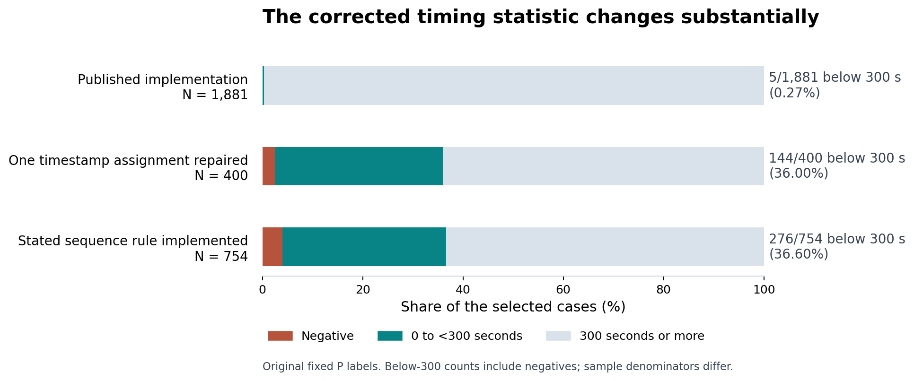

# A correction to the 2022 Patoshi timing test

**Zakk Easterbrook**

This note identifies an implementation error in the PHP script linked from [Jameson Lopp's 2022 article](https://blog.lopp.net/was-satoshi-a-greedy-miner/), reproduces its reported counts, and separates a minimal timestamp repair from a direct implementation of the article's stated rule.

## 1. Define the test

Let **A, B and C** be three consecutive block heights. Write their header timestamps as `tA`, `tB` and `tC`. The supplied list classifies A and B as Patoshi, abbreviated **P**; C is outside that list, abbreviated **N**. These labels describe membership in the published input list.

The article specifies:

1. A consecutive **P → P → N** sequence.
2. `tB - tA < 600` seconds.
3. Measurement of `d = tC - tB`.

The inequalities are strict. The sequence rule does not add a lower bound to the A-to-B difference. A selected output equal to 300 seconds is excluded from the “below 300” count; a negative output is included.

The input consists of **50,000 headers**, heights 0 through 49,999, and **21,953 unique ascending P labels**, from height 3 through 49,973. The label list is identical in all three calculations. Its range is a property of this script's input and should not be confused with broader ranges discussed elsewhere in the article. [Input provenance](provenance.md) records both files and their hashes.

## 2. The wrong timestamp is assigned

The [pinned source](https://github.com/jlopp/bitcoin-utils/blob/66ee906b28ca13269d6f71d63f848973a1b747a2/findNonPatoshiDeltasAfterFastPatoshiBlocks.php) fetches the second P block, but reads the first block's response when setting the second timestamp variable. The minimal change is:

```diff
-$patoshiBlock2Time = $patoshiBlock1->get('time');
+$patoshiBlock2Time = $patoshiBlock2->get('time');
```

This single assignment affects two operations:

| Operation | Intended expression | Expression produced by the defect |
|---|---|---|
| Time filter | `tB < tA + 600` | `tA < tA + 600` |
| Reported difference | `tC - tB` | `tC - tA` |

The defective filter is always true for these integer timestamps. The reported difference also includes the preceding P-to-P interval:

```text
reported difference = intended difference + (tB - tA)
```

Across the original 1,881 selected cases, the added interval is positive, ranging from **22 to 6,865 seconds**. Thus every reported value in that original sample is inflated. This sign was checked on the data; increasing parent-to-child timestamps are not assumed as a general Bitcoin rule.

The repair consequently changes both the values and the eligible sample. Comparing the three totals without acknowledging their different denominators would obscure that distinction.

## 3. Blocks 263–265 illustrate the error

| Block | List membership | Unix header timestamp | Header timestamp, UTC |
|---|---|---:|---|
| 263 — A | P | 1,231,805,421 | 2009-01-13 00:10:21 |
| 264 — B | P | 1,231,805,980 | 2009-01-13 00:19:40 |
| 265 — C | N | 1,231,806,051 | 2009-01-13 00:20:51 |

The arithmetic is directly checkable:

```text
tB - tA = 559 seconds  → passes the <600-second filter
tC - tB =  71 seconds  → the intended observation
tC - tA = 630 seconds  → the original script's output
```

The original code therefore turns a qualifying observation below 300 seconds into an observation above 300 seconds. This case remains selected after the assignment repair, so it demonstrates the measurement error without depending on the separate run-selection omissions. The complete raw headers are in [the binary input](../data/headers_0_49999.bin), and child height 265 appears in each [expected result CSV](../results/expected/).

The computed mainnet block hashes are:

```text
263  00000000803cec62b96ccbb70affe0f05f351ada18d14a16960783aeafe0d8fc
264  00000000641f9b99064bda263144a08761757b566357f49e95f516b0b5a4b778
265  000000001cd3ea335cdf6fbffe7fa954f761d16ff19893f04465916a3f5f5dc3
```

For height `h`, its exact serialized header occupies bytes `80*h` through
`80*h+79`, inclusive, in the binary input. Thus the three headers begin at
offsets 21,040, 21,120 and 21,200. The four little-endian timestamp bytes are
at relative offset 68 in each header. Displayed hashes reverse the bytes of
the double-SHA-256 digest; the serialized previous-hash field uses internal
byte order. The [methodology](methodology.md) describes these checks.

## 4. Why the minimal repair and stated rule differ

The original program tracks consecutive P heights and evaluates a run when it encounters a gap. Two details omit cases allowed by the article's rule:

- It requires **more than two stored heights**, although the rule requires only the final two consecutive P blocks before an N child.
- When a gap breaks a run, it clears the tracker and discards the current P height instead of retaining that height as the beginning of the next run.

The **timestamp-only** variant preserves both behaviors and changes only the assignment shown above. The **stated-rule** variant scans every consecutive triple directly, testing list membership and the strict time condition. This direct scan adds **354 qualifying cases**, taking the count from 400 to 754.

The original loop also has no final flush. Its actual input ends with an empty tracker, so that omission changes none of the historical totals reported here. Synthetic regression fixtures test that edge case separately; see [regression tests](regression-tests.md).

## 5. Full results

| Calculation | Selected cases | `d < 0` | `d < 300`, including negatives | `0 ≤ d < 300` |
|---|---:|---:|---:|---:|
| Original implementation | 1,881 | 1 | 5 | 4 |
| Timestamp assignment repaired | 400 | 10 | 144 | 134 |
| Stated sequence rule implemented | 754 | 30 | 276 | 246 |

For the original implementation, `d` in this table is its emitted C-minus-A value. In the corrected variants, `d` is C-minus-B. Each row uses its own selected sample.

The disjoint categories used in the figure are:

| Calculation | Negative | 0–299 seconds | At least 300 seconds |
|---|---:|---:|---:|
| Original implementation | 1 | 4 | 1,876 |
| Timestamp assignment repaired | 10 | 134 | 256 |
| Stated sequence rule implemented | 30 | 246 | 478 |



The original three headline counts reproduce the article's **1,881 / 1 / 5** exactly. The original-day archive and current page contain the same affected passage; see [article provenance](provenance.md#article-and-archive).

Complete expected outputs are [original.csv](../results/expected/original.csv), [timestamp_only.csv](../results/expected/timestamp_only.csv) and [literal_rule.csv](../results/expected/literal_rule.csv). Each row identifies the child block height and the emitted timestamp difference in seconds. `reproduce.py` regenerates the files and requires byte-for-byte equality.

The effects can also be separated on a fixed sample. Keeping all 1,881
legacy-selected cases but measuring C-minus-B gives **121 negative values and
713 below 300 seconds**. Restoring the intended A-to-B filter removes **1,481
cases**, leaving 400. Replacing the tracker with the stated sequence rule adds
354 qualifying cases, giving 754. The first step is a diagnostic calculation,
not the fully corrected advertised test.

The original negative output has child height **24,143**. Its preceding gap is
1,485 seconds, its C-minus-B value is −2,892 seconds, and its original C-minus-A
output is −1,407 seconds. It fails the intended preceding-gap filter. Both
corrected variants include an output of exactly **300 seconds at child height
9,656**; that row is excluded from their strict below-300 totals. None of the
three variants has an output of zero on this input.

## 6. Computational verification

The offline Python reproduction first validates the binary header input and its SHA-256, the mainnet genesis hash, every previous-hash link, proof of work, difficulty values and median-time-past conditions. It also checks the canonical classification-list hash and recorded header observations from two public explorers. The readable header JSON is rebuilt under `build/` from those verified binary bytes.

The native harness executes actual PHP with configuration loading disabled by `-n`. A small offline adapter supplies the block-hash and timestamp responses used by the source. The original variant preserves the published source bytes; the timestamp variant changes only the defective assignment in a temporary copy. A separate PHP routine scans the stated rule directly. Every emitted row is compared with a fresh Python result.

The supplied archive records an earlier native execution using PHP 8.3.6.
Those records are retained as historical execution evidence, separate from
the [current verification status](verification.md) and its actual runtime.
Neither run reconstructs the author's complete 2022 Composer dependencies or
node environment. The adapter, source hash checks and execution commands are
available for review in [the native runner](../scripts/run_native.py) and
[native directory](../native/).

Header checks do not revalidate transaction scripts or establish actual discovery and broadcast times. Historical receiving-node clocks are unavailable for recreating the contemporaneous future-time check. The mainnet prefix is anchored by its final hash and additional recorded comparisons, as detailed in [provenance](provenance.md).

## 7. Interpretation and review status

The verified conclusion is that **the published counts do not measure the test described in the article**. The assignment error both defeats the time filter and substitutes a different interval; the tracker separately omits qualifying sequences.

The correction leaves the supplied classifications unchanged. It does not determine the physical cause of the timestamp distribution. Other miners can find blocks while one miner pauses, and header timestamps can differ from actual event times. Distinguishing those possibilities would require a specified model and further evidence. The earlier [timestamp analysis by Sergio Demian Lerner](https://bitslog.com/2020/06/22/a-new-mystery-in-patoshi-timestamps/) already discussed multiple explanations.

External human review remains pending. Agreement between implementations and passing tests are computational checks, not a peer-review endorsement. Reproducible corrections to the analysis are welcome through the [review process](../CONTRIBUTING.md).
